# INFS7203 Track 1 — Credit-card default prediction

| | |
|---|---|
| **Student number** | 49769959 |
| **UQ username** | s4976995 |
| **Course** | INFS7203, Track 1 |
| **Prediction file** | `s4976995.infs7203` |

## Summary

The task is to predict whether a credit-card client will default next month (`defaulted_next_month`,
positive class `yes`). The final model is a **random forest** with balanced class weights, 100 trees,
maximum depth 10 and entropy splits. Missing numeric and repayment values are left for the trees to
route during training rather than being filled in.

Five-fold development results for the final model (mean ± sample standard deviation):

| Metric | Score |
|---|---|
| Accuracy | 0.772 ± 0.005 |
| Precision (yes) | 0.487 ± 0.010 |
| Recall (yes) | 0.535 ± 0.012 |
| **F1 (yes)** | **0.509 ± 0.010** |
| Macro-F1 | 0.681 ± 0.007 |
| Balanced accuracy | 0.687 ± 0.007 |

The earlier median/mode-imputed forest scored F1 0.502 ± 0.010. The executed `development.ipynb`
contains the full data audit, every experiment and the final checks; `main.py` reproduces the final
model and prediction file. Because the same development folds were used to choose the model, the
reported score may be somewhat optimistic.

**Contents:** [Running the program](#running-the-program) · [Submission contents](#submission-contents) ·
[Final model](#final-model) · [Techniques](#techniques-used-why-and-where) ·
[F1 improvement](#how-the-f1-score-improved) · [Results](#development-results) ·
[Experiments](#experiments-and-decisions) · [Limitations](#limitations) ·
[Reproducibility](#reproducibility) · [Sources](#course-scope-and-sources) · [Figures](#figures) ·
[Verification](#verification) · [AI acknowledgement](#ai-acknowledgement)

## Running the program

Place the supplied datasets at `data/development.csv` and `data/test.csv`, relative to this folder
(they are not included in the ZIP). With the dependencies from [Reproducibility](#reproducibility)
installed, run:

```powershell
python main.py
```

The program:

1. reads both datasets without modifying them;
2. recomputes the final model's five-fold development scores;
3. trains the same pipeline on all 24,000 labelled rows;
4. predicts all 6,000 test rows in their original order and writes **`s4976995.infs7203`**.

Input paths are resolved relative to `main.py`, so the program can be started from any folder.
No parameter or threshold search is performed.

The output file has no header and exactly 6,001 rows. Rows 1–6,000 are `yes,` or `no,`; the last row
holds mean accuracy, precision(yes), recall(yes), F1(yes) and macro-F1, in that order:

```text
0.772,0.487,0.535,0.509,0.681,
```

The predictions contain 1,420 `yes` and 4,580 `no` labels.

## Submission contents

`s4976995.zip` contains:

- **`main.py`** — the final pipeline, validation and prediction program.
- **`development.ipynb`** — the executed development notebook.
- **`README.md`** — this report.
- **`requirements.txt`** — pinned direct dependencies.
- **`s4976995.infs7203`** — the 6,000 test predictions and the validation-metric row.
- **`figures/`** — the 12 figures used in this report.

Datasets, teaching materials, trained models, virtual environments and Git history are excluded.
Filenames use the UQ username `s4976995`. The prediction file uses the `.infs7203` extension given in
the rubric for INFS7203; the brief's filename examples use `.infs4203`.

## Final model

The model uses all 23 supplied predictors. `client_id` is excluded because it identifies a client
rather than describing them. All clients are kept, and no ratios, aggregates or reconstructed
financial values are added.

1. **Numeric predictors** (`credit_limit`, `age`, six bill amounts, six payment amounts) pass through
   unchanged. Missing entries stay as NaN, and each tree split learns which branch should receive them.
2. **Demographics** (`sex`, `education`, `marital_status`) are filled with the training fold's most
   frequent value and one-hot encoded. Categories unseen in training are ignored by the encoder.
3. **Repayment status** (six monthly columns) is ordinal encoded. Missing or unseen statuses stay as
   NaN, so absence is not treated as an ordinary repayment category.
4. **Classifier:** `RandomForestClassifier(n_estimators=100, criterion="entropy", max_depth=10,
   min_samples_leaf=1, class_weight="balanced", random_state=42, n_jobs=-1)`. Other settings are
   defaults, including `max_features="sqrt"` and `bootstrap=True`.
5. **Decision rule:** predict `yes` when P(yes) ≥ **0.50**, otherwise `no`. The `yes` probability column
   is located through `classes_` rather than assumed.

Known repayment statuses receive codes 0–10 in this order: `no_balance`, `paid_on_time`,
`revolving_credit`, then `payment_delayed_1_month` to `payment_delayed_8_months`. Delay lengths have a
natural order; the order of the first three labels is a modelling assumption. Missing repayment status
is never inferred from bill or payment amounts.

All learned steps sit inside a `Pipeline` and `ColumnTransformer`, so cross-validation fits a fresh
pipeline on each training fold and scores only the held-out rows. No validation or test label is used
in preprocessing. The trees need no scaling, because scaling does not change the order of values that
splits depend on; scaling is used only in the k-NN and naive Bayes comparisons.

Balanced class weights give the minority `yes` class more influence during training. Entropy measures
how mixed the classes are when choosing a split. Each tree is trained on a bootstrap sample with random
feature subsets, and the forest averages the trees' probabilities. Native missing-value support is part
of scikit-learn's [RandomForestClassifier](https://scikit-learn.org/stable/modules/generated/sklearn.ensemble.RandomForestClassifier.html).

## Techniques used: why and where

All four required classifier families were trained and compared before one final classifier was
chosen, as permitted by the staff clarification on comparisons.

| Technique | Why it is used | Where it is implemented |
|---|---|---|
| Data audit; exclude `client_id`; keep the 23 supplied predictors | Check the data and avoid learning from an identifier | Notebook Phase 1; `main.py` predictor lists and `main()` |
| Mean, median and mode imputation | Compare standard treatments of missing data | Notebook Phases 2–4; final `build_pipeline()` uses mode for demographics |
| Explicit missing categories and numeric missing indicators | Test whether recording absence separately helps | Notebook Phases 4d/4f; not selected |
| Native forest missing-value handling | Keep numeric/repayment NaNs distinct from observed values | Final `build_pipeline()` (numeric passthrough, repayment encoder); Phases 4d/6 |
| One-hot encoding | Represent nominal labels without inventing an order | Final `build_pipeline()` for demographics; repayment comparisons in Phases 2b/3/4d/4f |
| Ordinal repayment encoding | One ordered code per month; first three labels' order is assumed | `STATUS_ORDER` and `build_pipeline()`; notebook Phase 2b |
| Z-score standardisation (`StandardScaler`) | Stop large amounts dominating neighbour distances | k-NN/NB pipelines, Phases 3/4f; not used by the final forest |
| Gaussian naive Bayes | Required probabilistic baseline | Notebook Phase 3 |
| k-nearest neighbours | Required distance-based baseline; neighbourhood size compared | Phase 3 (k=5); Phase 4f (k=15/31) |
| Decision tree | Required single-tree baseline; depth and class weighting compared | Notebook Phases 2–4 |
| Random forest | Required classifier and the permitted ensemble | Notebook Phases 3–4f; final `build_pipeline()` |
| Gini/entropy, depth and minimum leaf size | Compare split criteria and control tree growth | Notebook Phases 4–4f; final entropy, depth 10, leaf 1 |
| Balanced class weights | Give the minority class more influence in training | Tree/forest comparisons; final `class_weight="balanced"` |
| Explicit, small hyperparameter comparisons | Reproducible, explainable alternatives | Phase 4 uses `ParameterGrid` and a loop; later phases use written candidate lists |
| Stratified five-fold CV, fixed seeds, out-of-fold probabilities | Fair held-out comparison with stable class balance | `cross_validated_scores()`; notebook `cv_folds` and `out_of_fold_yes_probabilities()` |
| `Pipeline` and `ColumnTransformer` | Fit every learned transformation on the training fold only | All evaluated pipelines and final `build_pipeline()` |
| Development threshold comparison | Balance precision and recall using development predictions only | Notebook Phases 4b–4f; final `predict_labels()` uses 0.50 |
| Six metrics with fold means and sample standard deviations | Optimise F1(yes) while showing trade-offs and variability | `score_labels()`, `cross_validated_scores()`; notebook Phase 6 |
| Refit on all development rows; preserve test order | Produce the required predictions reproducibly | `main()` and `write_output()`; notebook Phase 6 |

Missing categories and indicators are taught in Lecture 2 (p.52). Built-in forest missing-value
handling, class weights and development threshold selection are permitted by staff clarifications.
No over/undersampling, SMOTE, KNNImputer, engineered financial features, boosting, stacking or voting
ensemble is used.

### Code structure

`main.py` has six functions:

- `main()` reads the datasets, runs validation, fits the final model and predicts the test rows.
- `build_pipeline()` defines the three preprocessing branches and the random forest.
- `cross_validated_scores()` fits a fresh model on each training fold and scores the held-out fold.
- `predict_labels()` applies the 0.50 probability threshold.
- `score_labels()` calculates the six metrics.
- `write_output()` writes the predictions and the five metric means in the required format.

Notebook Phase 6 writes out the same recipe as `build_final_pipeline()`; earlier phases record how it
was reached.

## How the F1 score improved

The earlier forest replaced missing numeric values with medians and missing repayment statuses with
the most common status, so the model could not tell a filled-in value from a real one. The final forest
keeps these values as NaN, and each tree learns from its training fold which branch they should follow.
This keeps "unknown" separate from ordinary observed values; it does not recover the missing data.

Two changes produced the gain:

1. **Missing-value handling.** With the earlier Gini criterion, native numeric/repayment handling
   raised F1 from **0.502192 to 0.507594** (+0.005402).
2. **Split criterion.** Keeping native handling, switching to entropy raised F1 from **0.507594 to
   0.509415** (+0.001821).

The two effects interact: switching only the old imputed forest to entropy gave 0.504552. All rows
below use the same seed-42 folds, 100 trees, depth 10, leaf 1, balanced weights and threshold 0.50.

| Approach | F1 (yes) | Balanced accuracy |
|---|---|---|
| Previous: median/mode + Gini | 0.502192 ± 0.009951 | 0.682106 ± 0.006419 |
| Native numeric only + Gini | 0.503564 ± 0.011195 | 0.683227 ± 0.007694 |
| Native numeric and repayment + Gini | 0.507594 ± 0.010114 | 0.685511 ± 0.006867 |
| Previous imputation + entropy | 0.504552 ± 0.006672 | 0.683843 ± 0.004393 |
| **Final: native numeric/repayment + entropy** | **0.509415 ± 0.010155** | **0.687164 ± 0.006932** |

Mean precision rose from **0.4813 to 0.4866** and mean recall from **0.5251 to 0.5346**. The total F1
gain is **0.007223** (0.72 percentage points, about 1.44% relative). Class weighting, tree count and
threshold were unchanged, so they do not explain this gain.

## Development results

All results use five stratified folds shuffled with seed 42; every compared configuration uses the
same folds, and randomised estimators use seed 42. Scores are means ± sample standard deviation
(`ddof=1`) over the five held-out folds (see the [Summary](#summary) table).

F1(yes) per fold is 0.519, 0.520, 0.497, 0.504 and 0.507. Selection used positive-class F1, the
assessed metric; macro-F1 is reported separately.

**Why the final model was adopted.** On the original folds F1 rose from 0.502192 to 0.509415. The new
configuration and threshold were then fixed and checked on two further fold assignments:

| Split seed | Previous F1 | Final F1 | Difference | Folds won by final |
|---|---|---|---|---|
| 42 (selection) | 0.502192 | 0.509415 | +0.007223 | 4/5 |
| 23 | 0.502784 | 0.509229 | +0.006445 | 4/5 |
| 91 | 0.505106 | 0.509836 | +0.004730 | 4/5 |

The gain held on both extra partitions. These partitions reuse the same clients, so they test
sensitivity to the fold assignment rather than providing independent evidence or statistical
significance. The reported score remains the original seed-42 result.

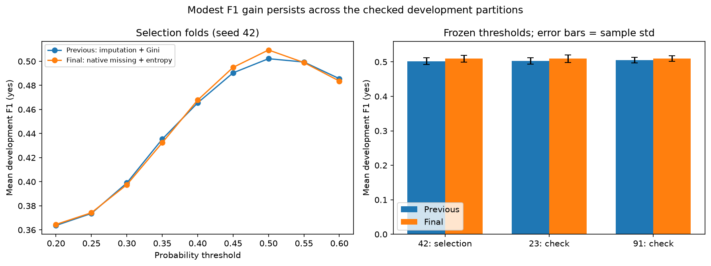

Left: both models peak at threshold 0.50 on the selection folds. Right: the gain appears on all three
partitions; error bars show fold-to-fold variation.

## Experiments and decisions

The notebook keeps the development history in order. Earlier phases describe the model at that stage;
**Phase 6 defines the final pipeline.** Every experiment table reports all six metrics, and selection
uses unrounded F1.

- **Data audit (Phase 1):** 24,000 development rows and 25 columns, with 5,309 `yes` and 18,691 `no`.
  There are 14 numeric and nine categorical predictors, each 40% missing. No rows were removed and
  unusual financial values were kept as supplied.
- **Preprocessing (Phase 2):** a depth-5 decision tree scored F1 0.371 with median numeric imputation
  and 0.365 with mean imputation. Ordinal repayment encoding raised the tree's F1 to 0.399.
- **Four model families (Phase 3):** ordinal random forest 0.408, ordinal depth-5 tree 0.399, k-NN
  (k=5, Euclidean, scaled) 0.320 and Gaussian naive Bayes 0.194.
- **Tuning (Phase 4):** forests compared class weights {None, balanced}, depths {None, 10} and leaf sizes
  {1, 10}; trees compared class weights {None, balanced} and depths {3, 5, 8} — 12 new configurations.
  The balanced depth-10, leaf-1 forest led with F1 0.502; the best tree (balanced, depth 5) scored 0.485.
- **Thresholds (Phase 4b):** for that forest, 0.2, 0.3, 0.4, 0.5 and 0.6 were compared, and 0.5 was
  best. Lower thresholds raised recall but reduced precision sharply.
- **Unweighted forests with tuned thresholds (Phase 4c):** 12 forest configurations at nine thresholds
  (0.20–0.60 in steps of 0.05). The best, an unweighted depth-12 forest at threshold 0.25, reached 0.505, but its small
  gain reversed on two further partitions (seeds 17 and 83), so it was rejected. Class weighting is
  therefore not the only route to this F1 level: an unweighted forest can come close once its own
  threshold is tuned.
- **Missing-value handling and split criterion (Phase 4d):** 14 configurations, 126
  configuration/threshold combinations and 70 fits. Numeric indicators alone reached 0.502435;
  half/all feature subsets 0.495863/0.494144; explicit missing categories with one-hot repayment
  0.507557; native handling with Gini 0.507594; native depth 8/12 0.506895/0.505792. Native handling
  with entropy led at **0.509415** and was adopted after the partition checks above.

### Final parameter check (Phase 4e)

Six variants of the final forest were compared with it at thresholds 0.46–0.56 (step 0.01; 77
combinations): 300 trees, depth 8 or 12, minimum leaf size 5 or 10, and `max_features=0.5`. A replacement required a gain of at
least 0.002 in mean F1, fixed before the run.

| Configuration | Best threshold | F1 (yes) | Balanced accuracy |
|---|---|---|---|
| **Final model (depth 10)** | 0.50 | **0.509415 ± 0.010155** | 0.687164 ± 0.006932 |
| 300 trees | 0.49 | 0.508189 ± 0.007782 | 0.687800 ± 0.005609 |
| Depth 8 | 0.49 | 0.508578 ± 0.009482 | 0.687403 ± 0.006607 |
| Depth 12 | 0.49 | 0.509592 ± 0.009042 | 0.688144 ± 0.006304 |
| Minimum leaf size 5 | 0.49 | 0.508172 ± 0.005685 | 0.688272 ± 0.003972 |
| Minimum leaf size 10 | 0.51 | 0.509055 ± 0.008561 | 0.686283 ± 0.005743 |
| Half the features per split | 0.49 | 0.504821 ± 0.007223 | 0.685419 ± 0.005448 |

The best variant (depth 12, threshold 0.49) was only 0.000177 higher, below the 0.002 margin, so the
depth-10 model at 0.50 was kept.

### Further preprocessing and model checks (Phase 4f)

Ten configurations, including the final model, were compared at thresholds 0.20–0.60 in steps of
0.05 (90 combinations, 50 fits), with the same 0.002 replacement margin.

| Configuration | Best threshold | F1 (yes) | Balanced accuracy |
|---|---|---|---|
| **Final model** | 0.50 | **0.509415 ± 0.010155** | 0.687164 ± 0.006932 |
| Missing demographic categories | 0.50 | 0.506840 ± 0.011706 | 0.685262 ± 0.008289 |
| One-hot repayment + missing category | 0.50 | 0.507684 ± 0.009010 | 0.686327 ± 0.006241 |
| Both categorical changes | 0.50 | 0.508705 ± 0.012250 | 0.687678 ± 0.008535 |
| Unweighted native forest, depth 10 | 0.25 | 0.506245 ± 0.010529 | 0.683527 ± 0.007011 |
| Unweighted full-depth forest, leaf 10 | 0.25 | 0.506149 ± 0.007245 | 0.687722 ± 0.005300 |
| Balanced forest, depth 6 / leaf 5 | 0.50 | 0.504805 ± 0.009872 | 0.682768 ± 0.006264 |
| Balanced full-depth forest, leaf 10 | 0.50 | 0.505786 ± 0.010199 | 0.685259 ± 0.007068 |
| k-NN, k=15 | 0.25 | 0.426725 ± 0.008199 | 0.629763 ± 0.006437 |
| k-NN, k=31 | 0.25 | 0.436384 ± 0.015284 | 0.637934 ± 0.010451 |

No option beat the final model. Larger neighbourhoods improved k-NN over its k=5 baseline, but k and
threshold changed together, so this is not an isolated effect of k.

## Limitations

- **Selection bias:** preprocessing, model, parameters and threshold were all chosen on the same
  development folds, so the reported score may be optimistic by an unknown amount. Extra partitions
  reuse the same clients and do not remove this bias.
- **Missingness mismatch:** every development predictor is 40% missing, while the test predictors have
  no missing values. Cross-validation may therefore track hidden-test performance imperfectly. The test
  data were not used to choose any method, threshold or parameter.
- **Coverage:** the comparisons are bounded. k-NN was tested with k=5, 15 and 31 and Euclidean distance
  only; other distances, category orders and larger searches were not explored.
- **Interpretability:** a 100-tree forest is harder to inspect than a single tree and does not reduce
  to one simple rule.
- **Data meaning:** the repayment ordering, negative bills and some status/payment combinations are
  interpreted cautiously; no financial corrections were made.
- **Environment:** native missing-value support and exact results depend on library versions; use the
  versions below.

## Reproducibility

Recorded environment: Windows 11 (`Windows-11-10.0.26200-SP0`), Python 3.13.13, numpy 2.5.4,
pandas 3.0.6, scikit-learn 1.9.1, matplotlib 3.11.2, scipy 1.18.1, joblib 1.6.0, threadpoolctl 3.7.0,
JupyterLab 4.6.4 and ipykernel 7.4.0. Direct dependencies are pinned in `requirements.txt`. The folds
and all randomised estimators use seed 42.

```powershell
python -m venv .venv
.\.venv\Scripts\python.exe -m pip install -r requirements.txt
.\.venv\Scripts\python.exe main.py
.\.venv\Scripts\python.exe -m jupyter nbconvert --to notebook --execute --inplace development.ipynb
```

Run `main.py` before the notebook: the notebook's final cells compare its predictions and metric row
with the file the program writes. The notebook also reruns every experiment, regenerates the figures and
prints the environment.

## Course scope and sources

The project brief sets the data, validation and output requirements. Teaching sources (PDF page
numbers):

- Lecture 2, pp.47–62 — encoding, missing values and scaling.
- Lecture 3, pp.9–20 and 55–74; Week 3 coding guide, pp.5–7 — decision trees, pruning, random forests
  and splitting criteria.
- Lecture 4, pp.8–24 and 50–61; Week 4 coding guide, pp.1–5 — k-NN, Gaussian naive Bayes,
  cross-validation and parameter comparisons.

Staff clarifications on Ed Discussion that informed these choices:
[repayment status and imputation](https://edstem.org/au/courses/37676/discussion/3571956),
[thresholds and grid search](https://edstem.org/au/courses/37676/discussion/3613188),
[class weights and built-in missing-value support](https://edstem.org/au/courses/37676/discussion/3628154),
[preprocessing restrictions](https://edstem.org/au/courses/37676/discussion/3627227),
[Random Forest as the ensemble](https://edstem.org/au/courses/37676/discussion/3619616) and
[positive-class F1](https://edstem.org/au/courses/37676/discussion/3615472).

## Figures

The final comparison appears under [Development results](#development-results). The figures below
document the data audit and earlier stages of development.

<details>
<summary>Data audit figures</summary>

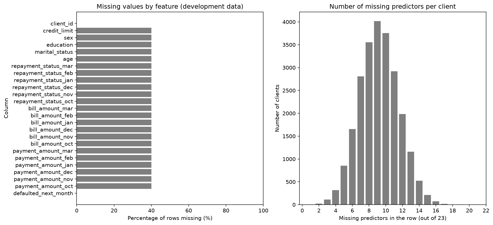
Each development predictor is 40% missing. This motivated the imputation comparisons and, later, the
missing-category and native missing-value experiments. The plot alone does not show why values are missing.

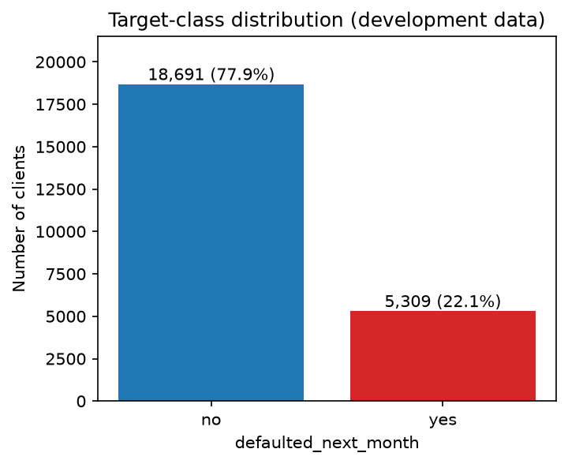
About 22.1% of clients default. Predicting `no` for everyone would give about 77.9% accuracy but zero
F1(yes), which is why F1 drives selection and why class weights and thresholds were compared.

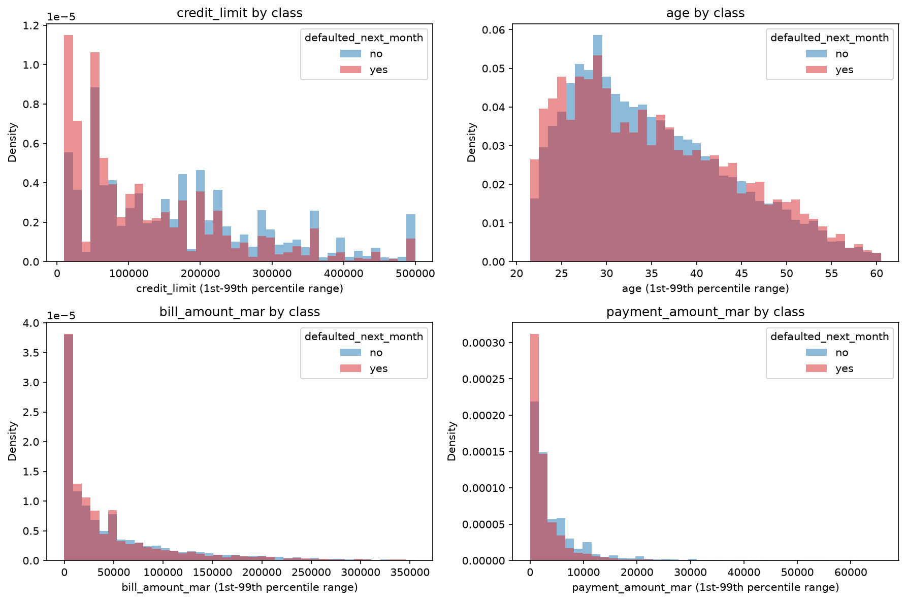
Amounts are skewed and include unusual values. Median imputation was a reasonable starting point, but
mean and median were both compared rather than chosen from the shape alone.

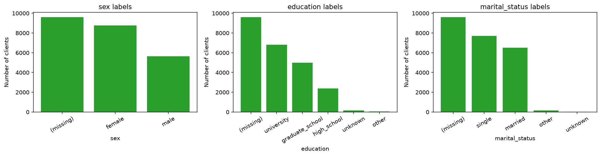
Category frequencies differ. One-hot encoding avoids inventing an order; missing demographics use the
training fold's most frequent value in the final model.

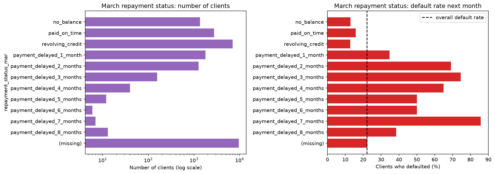
Repayment categories are unevenly represented. Ordinal and one-hot encodings were compared; the order of
the non-delay labels remains an assumption.

</details>

<details>
<summary>Earlier experiment figures</summary>

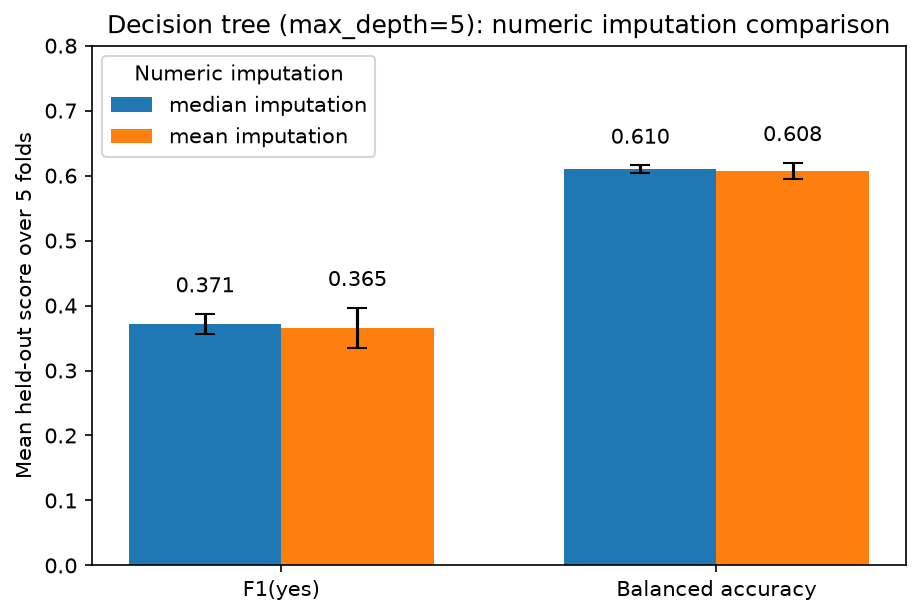
The depth-5 tree showed only a small mean/median difference. Median was kept at that stage; the final
forest later replaced numeric imputation with native handling.

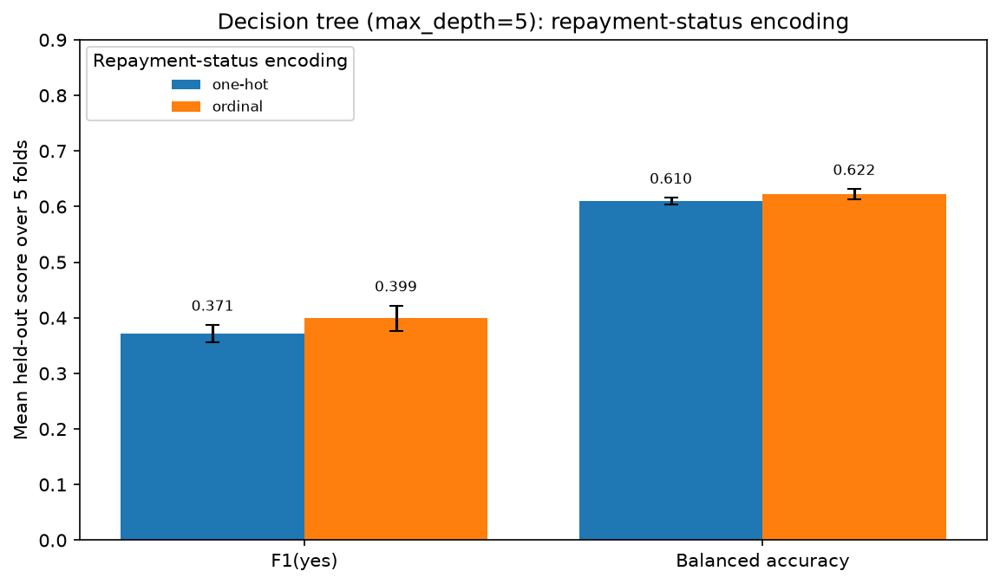
Ordinal encoding outperformed one-hot encoding for the depth-5 tree, so ordinal encoding was also tested
for the forest.

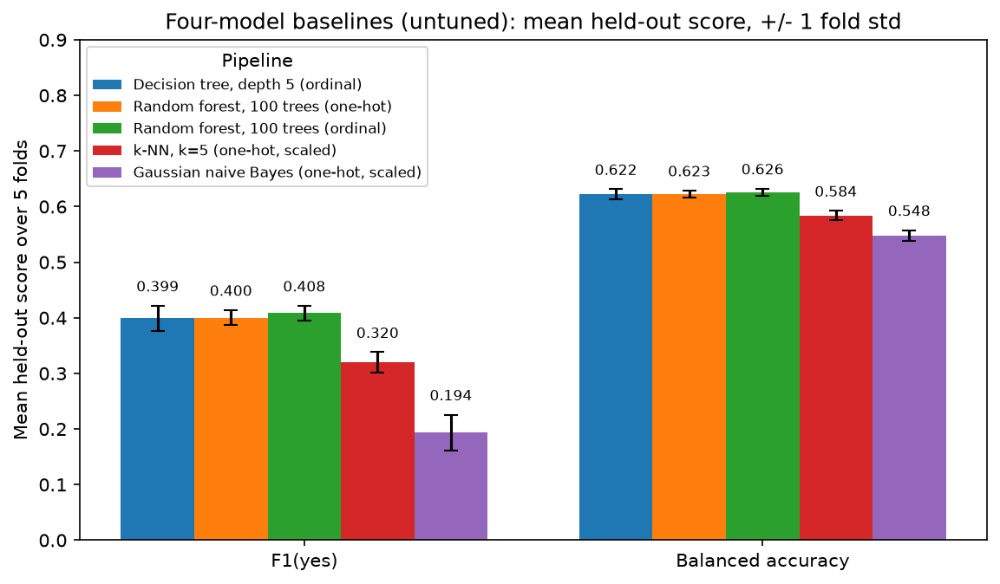
Tree and forest pipelines outperformed k-NN and naive Bayes, so tuning focused on the tree families.

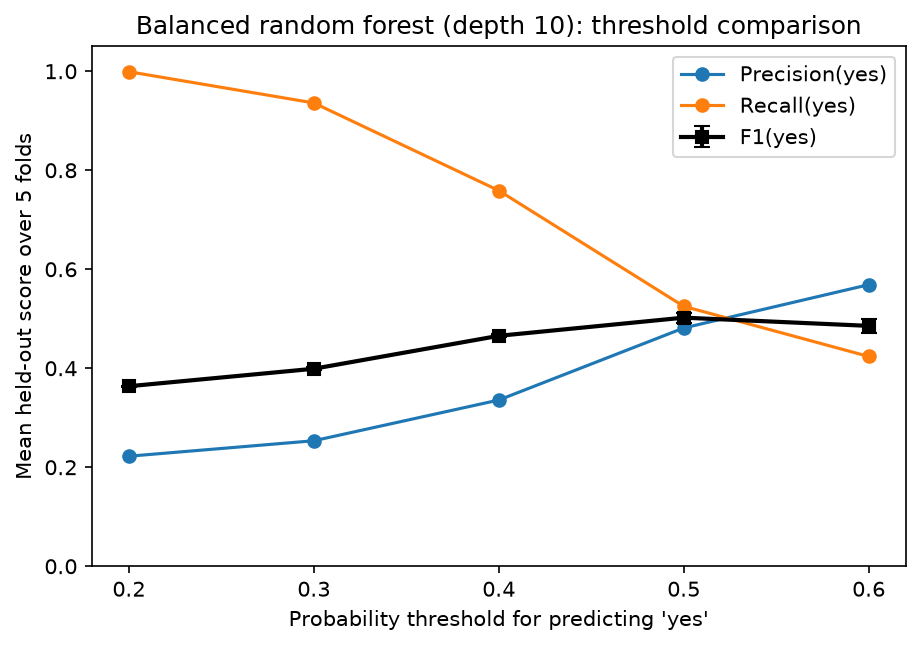
For the earlier imputed Gini forest, 0.50 was the best tested threshold.

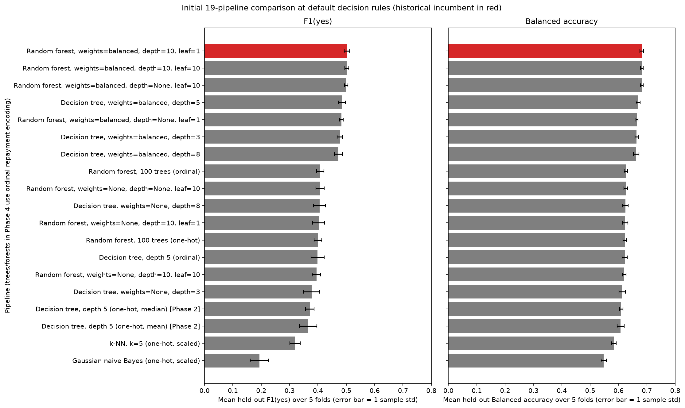
The red bar marks the earlier selected model. Balanced forests led these comparisons at the default
threshold; this figure predates the final native-missing, entropy forest.

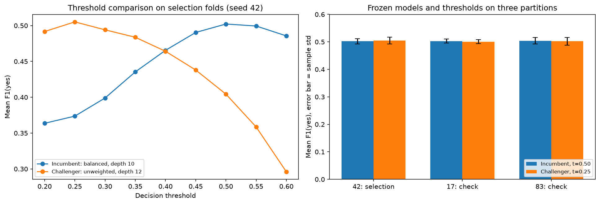
The unweighted depth-12 forest's small advantage reversed on the extra partitions, so it was rejected.

</details>

## Verification

The following checks were run in the recorded environment:

- **Notebook:** all 70 code cells ran in order from a fresh kernel without errors.
- **Notebook versus `main.py`:** identical fold metrics and identical labels for all 6,000 test rows.
  All six metrics were also recalculated directly from confusion-matrix counts.
- **Repeatability:** repeated runs of `main.py` produced byte-identical output. Single-core and parallel
  runs, and reversed test-row order, gave the same labels.
- **Inputs and format:** inputs with missing or unseen categories produce valid predictions; the output
  file meets the required 6,001-row format; the datasets are unchanged after running.
- **Package:** `pip check` reports no broken requirements. Running `main.py` from a clean extraction of
  the ZIP, with the datasets added, reproduced the packaged prediction file byte for byte.

A fresh dependency installation and other operating systems were not tested.

## AI acknowledgement

OpenAI Codex and Cursor's AI coding assistant were used **under my direction and supervision** to help
organise source material, write Python code, run experiments and reproducibility checks, and draft
explanations and documentation. I supplied the course materials and staff clarifications and directed
the scope of the work.
